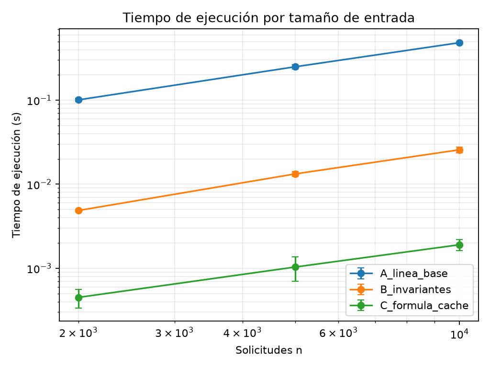
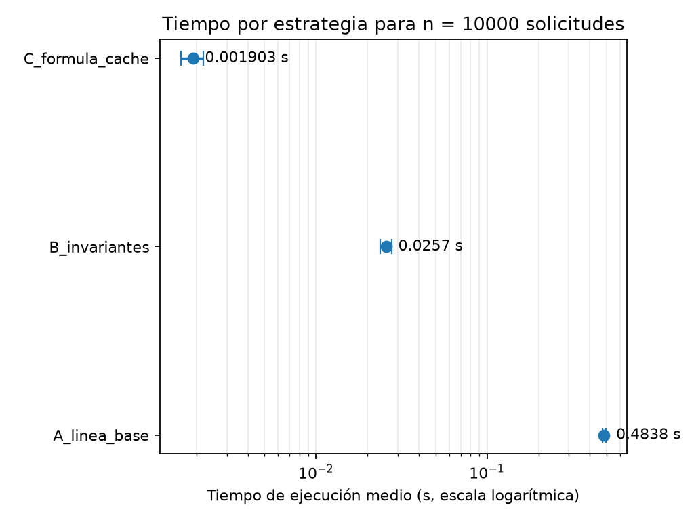

# Rendimiento de estrategias para calcular intereses de créditos

**Equipo:** 5 · **Integrantes:** Joel Andrés Mendoza Buriticá (A), Sebastian Ramirez Castrillon (B) y Luis Felipe Sierra (C) · **Fecha:** 25 de noviembre de 2026 · **Repositorio:** [CasoFisica](https://github.com/JBUR10/CasoFisica)

## Resumen

Se compararon tres cálculos del interés total de créditos del sistema francés, con 10 corridas por estrategia para lotes de 2.000, 5.000 y 10.000 solicitudes. Los datos se generaron con semilla fija y el orden de medición se aleatorizó. Para 10.000 solicitudes, A tardó en promedio 0,4838 s; B, 0,02570 s; y C, 0,001903 s. B redujo el tiempo 94,69 % y C 99,61 % frente a A. Las implementaciones conservaron el total monetario con diferencia máxima observada de 0,01 COP. La evidencia respalda las optimizaciones en el rango ensayado, aunque la dispersión relativa de C fue alta porque sus corridas duraron pocos milisegundos. No se midieron energía ni temperatura.

## 1. Introducción

FinanCréditos Cooperativa es un caso simulado de un servicio que recalcula planes de pago y reporta saturación de CPU en horas pico. La pregunta experimental fue: **¿cómo cambia el tiempo de ejecución al cambiar la estrategia y el número de solicitudes, manteniendo los mismos datos, equipo y versión de Python?**

Para capital `P` (COP), tasa mensual `i` (adimensional) y plazo `m` (meses), la cuota fija es `C = P·i / (1 − (1+i)^−m)`. En el sistema francés, la suma de pagos es `m·C`; al descontar el capital, el interés total es `I_total = m·C − P`. La estrategia A vuelve a calcular la cuota en cada mes; B calcula sus invariantes una vez por crédito; C usa la identidad del total y almacena en caché el factor asociado a cada par tasa–plazo.

La reducción de operaciones debe reflejarse en menos tiempo de CPU bajo condiciones comparables. El contador `perf_counter()` mide duración de pared con un reloj de alta resolución y `process_time()` acumula tiempo de CPU del proceso; son magnitudes distintas ([documentación de Python sobre time](https://docs.python.org/3/library/time.html)). La caché de C reutiliza hasta 256 resultados recientes según sus argumentos ([documentación de Python sobre `lru_cache`](https://docs.python.org/3/library/functools.html#functools.lru_cache)).

## 2. Hipótesis

Las predicciones y los criterios completos están en [docs/hipotesis.md](hipotesis.md). Se completaron después de generarse el CSV, por lo que se interpretan como hipótesis exploratorias, no como predicciones preregistradas.

- **H1:** B reducirá al menos 90 % el tiempo medio frente a A en cada tamaño. Respaldada: los IC95 % cumplen el umbral conservador definido en la hipótesis para los tres tamaños.
- **H2:** C reducirá al menos 99 % el tiempo medio frente a A en cada tamaño. Respaldada: los IC95 % cumplen el umbral conservador para los tres tamaños; la dispersión relativa de C obliga a mantener cautela.
- **H3:** la diferencia absoluta del interés total será ≤ 0,01 COP. Respaldada justo en el límite: la diferencia máxima recalculada fue 0,01 COP para C con n=5.000. El arnés y las pruebas existentes usan esa misma tolerancia.

## 3. Método

Se compararon A (simulación original), B (potencia y cuota fuera del ciclo mensual) y C (fórmula cerrada y caché tasa–plazo). Las variables independientes fueron estrategia y tamaño `n`; la variable principal fue el tiempo de pared en segundos. También se registraron tiempo de CPU y porcentaje calculado de CPU. El pico de memoria se tomó en una corrida separada por combinación, con `tracemalloc`, para no mezclar su sobrecosto con el tiempo.

Para cada tamaño se generó una sola lista de solicitudes con `semilla=5` y se reutilizó para las tres estrategias. Se ejecutó un calentamiento por estrategia, se mezcló el orden con semilla 42 y se hicieron 10 mediciones temporales por combinación: 90 mediciones en total. Las filas de memoria se excluyeron del resumen de tiempo. La corrección se verificó comparando cada resultado con A usando tolerancia de 0,01 COP.

El equipo fue un ASUS TUF Gaming A15 FA506NCG con Windows 11 y CPython 3.13.15, 12 núcleos lógicos y 16 GB de memoria instalada. No quedaron registrados alimentación ni aplicaciones abiertas. `psutil`, sensores de frecuencia y temperatura y RAPL no estaban disponibles. Los detalles están en [docs/entorno.md](entorno.md) y el procedimiento en [docs/protocolo.md](protocolo.md).

## 4. Resultados

La tabla presenta media, mediana, desviación estándar muestral, CV e IC95 % de la media. Los intervalos se calcularon con la t de Student para 9 grados de libertad (10 repeticiones). No se excluyeron datos.

| Estrategia | n (solicitudes) | Media (s) | Mediana (s) | s (s) | CV (%) | IC95 % de la media (s) |
|---|---:|---:|---:|---:|---:|---:|
| A línea base | 2.000 | 0,100928 | 0,103251 | 0,006966 | 6,902 | [0,095945; 0,105911] |
| B invariantes | 2.000 | 0,004865 | 0,004852 | 0,000248 | 5,107 | [0,004687; 0,005043] |
| C fórmula y caché | 2.000 | 0,000449 | 0,000415 | 0,000158 | 35,188 | [0,000336; 0,000563] |
| A línea base | 5.000 | 0,250177 | 0,247807 | 0,020207 | 8,077 | [0,235722; 0,264631] |
| B invariantes | 5.000 | 0,013276 | 0,013093 | 0,001296 | 9,760 | [0,012349; 0,014202] |
| C fórmula y caché | 5.000 | 0,001034 | 0,000872 | 0,000470 | 45,426 | [0,000698; 0,001370] |
| A línea base | 10.000 | 0,483773 | 0,478911 | 0,014266 | 2,949 | [0,473569; 0,493978] |
| B invariantes | 10.000 | 0,025698 | 0,025077 | 0,002828 | 11,005 | [0,023675; 0,027721] |
| C fórmula y caché | 10.000 | 0,001903 | 0,001776 | 0,000390 | 20,516 | [0,001624; 0,002182] |

Para n = 10.000, B fue 18,8 veces más rápida que A, equivalente a una reducción media de 94,69 %; C fue 254 veces más rápida, una reducción de 99,61 %. Las reducciones son razones de medias observadas, no una garantía de capacidad en producción.

**Figura 1.** Tiempo medio por tamaño, escala log–log y barras de error IC95 %. Entre 2.000 y 10.000 solicitudes, el ajuste exploratorio de tres puntos produce pendientes aproximadas de 0,98 para A, 1,04 para B y 0,90 para C. Son compatibles con crecimiento aproximadamente lineal respecto a `n` en este portafolio; no caracterizan otros plazos o tamaños.

**Figura 2.** Medias e IC95 % para n = 10.000. El eje temporal es logarítmico para que también se vea C.

Los CV sobrepasaron 10 % en B con n=10.000 y en C para los tres tamaños. No se detectó una causa puntual en el registro; las llamadas de C duran aproximadamente 0,00045–0,00190 s, de modo que variaciones pequeñas del sistema producen CV grandes. Esos grupos deben repetirse con una medición por lotes más larga antes de comparar diferencias finas. Sus medias e intervalos siguen muy por debajo de A.

La memoria rastreada fue de 0,002–0,003 MiB en las corridas separadas; fue una sola lectura por combinación y `tracemalloc` no representa toda la memoria residente. Se reporta solo como referencia, no como evidencia de una ventaja robusta de memoria. El CSV también incluye tiempo de CPU del proceso, pero las lecturas muy breves presentan cuantización visible; no se usa el porcentaje calculado para afirmar uso sostenido de CPU.

## 5. Discusión

**Decisión de hipótesis.** H1 y H2 quedan respaldadas para los tres `n`: los IC95 % de B y C quedan debajo de 10 % y 1 %, respectivamente, del límite inferior del IC95 % de A. Se usó esta regla de intervalos, no una prueba p. H3 queda respaldada justo en el límite de tolerancia: los totales redondeados coinciden salvo una diferencia de 0,01 COP para C con n=5.000. Esto comprueba los conjuntos ensayados y no garantiza toda entrada posible.

**Interpretación física.** A ejecuta repetidamente una potencia de orden `m` dentro de un ciclo que ya recorre `m` meses, lo que introduce trabajo proporcional a `m²` por solicitud. B elimina esa repetición y conserva el recorrido mensual; C evita el recorrido y reutiliza factores. Con la mezcla fija de plazos del portafolio, los tres tiempos observados crecen aproximadamente como `n`; la mejora entre estrategias se explica por menos operaciones por crédito, no por una reducción de solicitudes.

El tiempo de CPU se relaciona con ciclos mediante `N ≈ f·t_CPU`. No se midió la frecuencia efectiva, por lo que no se estimó `N`. Tampoco se midió potencia ni energía: `E = P̄·t` solo permitiría inferir un cambio de energía bajo una potencia media comparable, condición no comprobada aquí. No se afirma ahorro eléctrico. Sin temperatura del chip ni ambiente tampoco se puede estimar el flujo de calor; el modelo `ΔT = P·R_total` explica por qué una potencia sostenida mayor eleva la temperatura y puede inducir reducción de frecuencia, pero es contexto teórico, no un resultado medido. El experimento fue secuencial y no midió concurrencia, así que no permite estimar escalamiento paralelo ni aplicar una predicción de Amdahl.

**Limitaciones.** Una sola máquina y una sola versión de Python; datos sintéticos con cartera acotada; n hasta 10.000; sensores de energía, frecuencia y temperatura ausentes; aplicación bajo carga individual, no bajo concurrencia; dispersión relativa alta en corridas breves; y falta de registro de aplicaciones abiertas y alimentación. El criterio de hipótesis se definió después de obtener los datos. Estas limitaciones restringen extrapolaciones a tráfico real.

## 6. Propuesta de mejora para la empresa

Priorizar un piloto de C para el cálculo de intereses por lotes, manteniendo A como referencia de auditoría y verificando una muestra de resultados monetarios. En la prueba de 10.000 solicitudes, C bajó el promedio de 0,4838 s a 0,001903 s: ahorro observado de aproximadamente **0,4819 s por lote (99,61 %)** en este equipo y **254×** de aceleración. Como alternativa gradual, B ahorró aproximadamente **0,4581 s por lote (94,69 %)** y conserva la simulación mes a mes.

La recomendación solo aplica como estimación inicial al portafolio y hardware ensayados. Antes del despliegue, repetir con lotes mayores y datos representativos, extender el tiempo de cada medida de C, ejecutar una prueba de concurrencia con el patrón de horas pico, validar tolerancias financieras con el responsable del producto y monitorizar tiempo, CPU, memoria y energía con instrumentos disponibles. Riesgos: diferencias de coma flotante en otras combinaciones, caché no representativa si cambian tasas/plazos y contención del servicio en paralelo. La prueba actual no permite prometer ahorro energético.

## 7. Conclusiones

En 2.000–10.000 solicitudes, las dos estrategias redujeron ampliamente el tiempo frente a A sin exceder la tolerancia monetaria observada. Para n=10.000, B redujo 94,69 % y C 99,61 % el promedio. La explicación es la eliminación de operaciones redundantes y del recorrido mensual. C es la candidata de mayor rendimiento, pero sus CV altos y la ausencia de prueba bajo concurrencia exigen una medición de seguimiento antes de un despliegue. No se midieron energía ni calor y no se atribuye ahorro en esas magnitudes.

## 8. Referencias

- [Documentación oficial de Python: módulo `time`](https://docs.python.org/3/library/time.html), descripción de `perf_counter()` y `process_time()`.
- [Documentación oficial de Python: `functools.lru_cache`](https://docs.python.org/3/library/functools.html#functools.lru_cache), semántica de la caché limitada.
- Proyecto Equipo 5: [línea base](linea_base.md), [variables](variables.md), [protocolo](protocolo.md), [entorno](entorno.md), [hipótesis](hipotesis.md), [CSV de mediciones](../resultados/resultados.csv) y [resumen estadístico](../resultados/resumen_estadistico.csv).

## Anexo Uso de IA

La IA ayudó a organizar el análisis, completar el resumen y mejorar la visualización. Las cifras se contrastaron con el CSV y el cálculo reproducible del proyecto. El registro de consultas está en [docs/uso_ia.md](uso_ia.md). La reflexión personal del integrante C queda pendiente de completar por el aprendiz.
